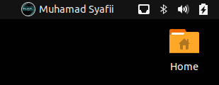
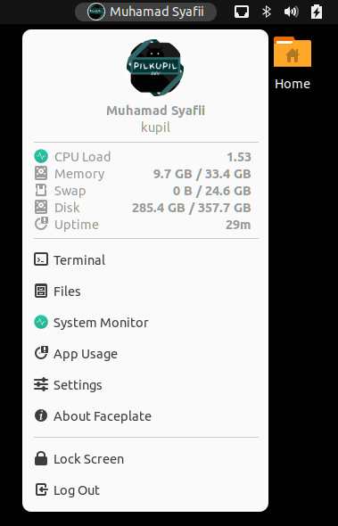
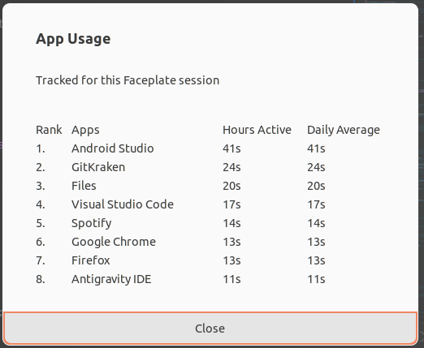
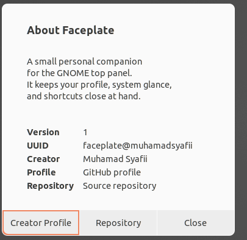
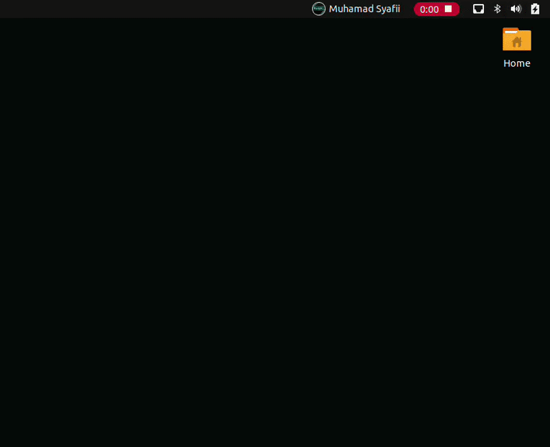

# Faceplate

Faceplate is a GNOME Shell extension that adds a compact personal profile menu to the top panel. It shows your account avatar and display name, then gives you quick access to system status, app shortcuts, session actions, and a lightweight app-usage view.

## ✨ Overview

Faceplate creates a dedicated profile item in the GNOME top panel. Click the avatar/name in the panel to open your personal Faceplate menu.

Inside the menu, you can see:

- 👤 your circular account avatar
- 🏷️ your display name and username
- 📊 CPU load, memory, swap, disk, and uptime
- 🚀 quick shortcuts for common desktop apps
- ⏱️ a session-based App Usage dialog
- 🔒 lock screen and log out actions

Faceplate is designed to feel native to GNOME Shell and follow your active system theme.

## 🖼️ Demo

### 🧭 Top Panel

Faceplate adds a compact avatar and display name to the GNOME top panel.



### 📋 Main Menu

The main menu shows your profile, system status, app shortcuts, and session actions in one place.



### ⏱️ App Usage

App Usage shows a simple ranked list of active applications for the current Faceplate session.



### ℹ️ About Faceplate

The About dialog includes extension details, creator information, and repository links.



### 🎬 Animated Preview



## 🚀 Features

- 👤 Circular avatar and display name in the GNOME top panel
- 🖼️ Larger circular avatar in the Faceplate menu
- 📊 Realtime system status while the menu is open
- ⚡ Quick shortcuts for Terminal, Files, System Monitor, Settings, and more
- ⏱️ App Usage dialog with ranked active-app tracking
- ℹ️ About Faceplate dialog with creator and repository links
- 🔒 Session actions for Lock Screen and Log Out
- 🎨 Optional custom avatar image
- 🧩 Optional custom launch command
- ↔️ Horizontal or vertical panel layout

## 🧩 Compatibility

Faceplate currently supports:

- GNOME Shell 42
- GNOME Shell 43
- GNOME Shell 44

GNOME Shell 45 and newer use a different extension API and are not supported by this version.

## 📦 Installation

### 🌐 Install From GNOME Extensions

After Faceplate is available on the GNOME Extensions website:

1. Open https://extensions.gnome.org
2. Search for `Faceplate`
3. Turn on the extension from the website
4. Open Faceplate from your GNOME top panel

### 📥 Install From GitHub Release

1. Download the latest `faceplate@muhamadsyafii.shell-extension.zip` file from the GitHub Releases page.
2. Install the ZIP file:

```bash
gnome-extensions install faceplate@muhamadsyafii.shell-extension.zip
```

3. Reload GNOME Shell.

On X11:

```text
Press Alt + F2, type r, then press Enter
```

On Wayland:

```text
Log out, then log back in
```

4. Enable Faceplate:

```bash
gnome-extensions enable faceplate@muhamadsyafii
```

### 🛠️ Install From Source

Clone the repository:

```bash
git clone https://github.com/muhamadsyafii/faceplate-gnome-shell-extension.git
cd faceplate-gnome-shell-extension
```

Copy the extension files into your local GNOME Shell extensions directory:

```bash
UUID=faceplate@muhamadsyafii
rm -rf ~/.local/share/gnome-shell/extensions/$UUID
mkdir -p ~/.local/share/gnome-shell/extensions/$UUID
cp -r metadata.json extension.js prefs.js stylesheet.css schemas ~/.local/share/gnome-shell/extensions/$UUID/
glib-compile-schemas ~/.local/share/gnome-shell/extensions/$UUID/schemas/
```

Reload GNOME Shell, then enable the extension:

```bash
gnome-extensions enable faceplate@muhamadsyafii
```

## 🧭 Usage

After enabling Faceplate, you will see your avatar and display name in the GNOME top panel.

Click it to open the Faceplate menu.

The menu contains three main areas:

- 👤 Profile: your avatar, display name, and username
- 📊 System status: CPU load, memory, swap, disk, and uptime
- ⚡ Apps and session: useful app shortcuts, App Usage, Settings, About Faceplate, Lock Screen, and Log Out

## ⚙️ Preferences

Open the preferences window with:

```bash
gnome-extensions prefs faceplate@muhamadsyafii
```

Available preferences:

- ↔️ `Layout Horizontal`: show the panel avatar and name side by side or stacked vertically
- 🖱️ `Default Click Action`: open the Faceplate menu or run a launch command directly
- 🚀 `Launch Command`: choose a preset command
- 🧩 `Custom Command`: command used when `Launch Command` is set to `Custom`
- 🎨 `Custom Avatar Path`: optional local image path used instead of your GNOME account avatar

If `Custom Avatar Path` is empty or invalid, Faceplate uses your GNOME account avatar. If no account avatar is available, it falls back to GNOME's default symbolic avatar icon.

## ⏱️ App Usage

Faceplate can show a simple App Usage dialog for the current extension session.

The dialog displays a ranked list like this:

```text
Rank  Apps                Hours Active   Daily Average
1.    Google Chrome       1h 3m          3m
2.    Visual Studio Code  42m            2m
```

Notes:

- ▶️ Tracking starts when Faceplate is enabled
- 🪟 Tracking is based on the currently focused window
- 🧠 Usage is stored in memory only
- 🔄 Usage resets when GNOME Shell or the extension restarts
- 📜 The list is scrollable when many apps are tracked
- 🧹 The dialog includes a reset action

## ❓ FAQ

### Does Faceplate replace the Ubuntu system menu?

No. Faceplate uses its own menu. It does not replace Ubuntu's built-in system menu.

### Can I use my own avatar image?

Yes. Open Faceplate preferences and set `Custom Avatar Path` to a local image file.

### Why is App Usage reset after restart?

App Usage is intentionally session-based in this version. It keeps the feature simple, private, and lightweight.

### Why is GNOME Shell 45 not supported yet?

GNOME Shell 45 introduced a newer extension API. Faceplate version 3 is focused on GNOME Shell 42, 43, and 44.

## 👨‍💻 Creator

Created by Muhamad Syafii.

- GitHub: https://github.com/muhamadsyafii
- Repository: https://github.com/muhamadsyafii/faceplate-gnome-shell-extension

## 📄 License

No license has been added yet.
